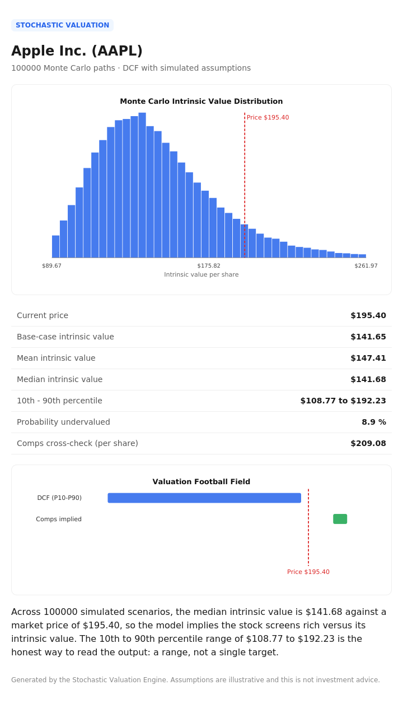

# Stochastic Valuation Engine

A C++ tool that values a public company with a discounted cash flow model, then runs a Monte Carlo simulation across the uncertain assumptions to produce a full distribution of intrinsic values instead of a single fragile point estimate. It cross-checks the result against comparable company multiples and exports a clean HTML report with charts.



## Why this exists

A single-point DCF is misleading. Move the discount rate half a percent and the answer swings wildly. This tool treats revenue growth, operating margin, WACC, and terminal growth as probability distributions, simulates 100,000 scenarios, and reports a valuation range plus the probability the stock is undervalued. Monte Carlo at that scale is where C++ genuinely earns its place.

## What you get out of the box

The core build depends only on the C++ standard library. No external packages, no API keys, no plotting library to install. It runs offline on the included sample data immediately, and produces:

- A console summary
- `output/report.html`, a self-contained report with an SVG histogram and football field
- `output/distribution.csv`, every simulated value for use in Excel or Python

## Build and run

You need a C++17 compiler. CMake is recommended but optional.

### With CMake (any OS)

```bash
cmake -B build -S .
cmake --build build
./build/valuation            # Windows: build\Debug\valuation.exe
```

### Without CMake (quick compile)

Linux or macOS:
```bash
g++ -std=c++17 -O2 -Iinclude src/*.cpp -o valuation
./valuation
```

Windows (MSVC Developer Command Prompt):
```bat
cl /std:c++17 /EHsc /O2 /Iinclude src\*.cpp /Fe:valuation.exe
valuation.exe
```

Windows (MinGW):
```bat
g++ -std=c++17 -O2 -Iinclude src/*.cpp -o valuation.exe
valuation.exe
```

### Toolchain setup if you do not have a compiler

- Windows: install Visual Studio Community with the "Desktop development with C++" workload, or MSYS2 for MinGW. Get CMake from cmake.org.
- macOS: `xcode-select --install` for the compiler, `brew install cmake`.
- Linux: `sudo apt install build-essential cmake`.

## Command-line options

```
./valuation --csv data/sample_company.csv --peers data/peers.csv --sims 100000 --out output
```

All flags are optional and fall back to the defaults shown above.

## Changing the company

Edit `data/sample_company.csv`. It is a simple key,value file. Revenue, net debt, and shares should use consistent units (millions works well, so shares in millions gives a per-share figure in dollars). The included sample uses illustrative Apple figures; replace them with numbers from a 10-K or a data provider.

Edit `data/peers.csv` to change the comparable set: one peer per row with enterprise value, EBITDA, and revenue.

## Project layout

```
include/   headers
src/       implementation
data/      sample company and peer CSVs
output/    generated report, chart, and raw distribution
```

## How the model works

1. `DcfModel` projects unlevered free cash flow for five years and adds a Gordon growth terminal value, discounted at the WACC, then bridges enterprise value to equity value and divides by shares.
2. `MonteCarloEngine` reruns that model thousands of times, each run drawing the four key assumptions from normal distributions centered on the base case.
3. `Statistics` summarizes the resulting distribution: mean, median, percentiles, and the probability the intrinsic value exceeds the current price.
4. `CompsAnalyzer` computes peer EV/EBITDA and EV/Revenue multiples and applies their medians to the target as a market-based cross-check.
5. `Reporter` prints the console summary and writes the HTML report with hand-built SVG charts.

## Next steps (optional add-on layers)

These are intentionally left out of the core so it builds with zero setup. Add them once the core works:

- Live data ingestion with libcurl and nlohmann/json, replacing the CSV input.
- A SQLite database to store each run and build a historical time series of your model's view.
- A tornado chart to rank which assumption moves the valuation most.

See the full build guide for code and schemas for each.

## Disclaimer

Assumptions are illustrative. This is a modeling exercise, not investment advice.
